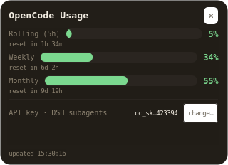

# OpenCode Usage panel

A small always-on-top GTK3 panel for Linux that shows how much of your
**OpenCode Zen** quota you have left, without opening a browser or watching a
terminal. Three progress bars — the rolling 5-hour window, the weekly window and
the monthly window — each with a countdown to its reset, plus optional rows for
the other free-tier accounts you may be juggling.



Frameless, translucent, always on top, and it remembers where you dragged it.

## What it shows

| Row | Source | Required? |
| --- | --- | --- |
| **Rolling (5 h)** | `GET https://opencode.ai/zen/go/v1/usage` | yes — this is the point |
| **Weekly** | same endpoint | yes |
| **Monthly** | same endpoint | yes |
| **OpenRouter daily** | `GET https://openrouter.ai/api/v1/auth/key` | optional key |
| **OpenCode subscription** | typed in by hand | optional |
| **Gemini 1 / Gemini 2 (router)** | a local router's usage table | optional |
| **Google Cloud credit** | BigQuery billing export | optional |
| **DSH server** | `/proc` + a loopback probe | only if you run `dsh web` |

Optional rows are **hidden until you configure them**, so a fresh clone shows
the three Zen bars and nothing that could only ever read zero. Each is driven by
an environment variable — see [Optional rows](#optional-rows).

## Requirements

- Linux with a Wayland or X11 session (GNOME on Wayland works; the launcher
  forces `GDK_BACKEND=x11` so the panel can place its own window)
- Python 3 with PyGObject and GTK3
- `pycairo` — draws the rounded bars and the translucent panel

```bash
# Debian / Ubuntu
sudo apt install python3-gi python3-gi-cairo gir1.2-gtk-3.0 python3-cairo

# Fedora
sudo dnf install python3-gobject gtk3 python3-cairo

# Arch
sudo pacman -S python-gobject gtk3 python-cairo
```

## Install

```bash
git clone https://github.com/falz1994/opencode-usage-panel.git
cd opencode-usage-panel
chmod +x usage_widget.py restart-panel.sh
```

Optional — install a launcher and autostart entry (edit the path if you cloned
somewhere else):

```bash
DIR="$PWD"
mkdir -p ~/.local/share/applications ~/.config/autostart
for d in ~/.local/share/applications ~/.config/autostart; do
  cat > "$d/opencode-usage-widget.desktop" <<EOF
[Desktop Entry]
Type=Application
Name=OpenCode Usage
Comment=OpenCode Zen usage: rolling, weekly and monthly limits
Exec=env GDK_BACKEND=x11 python3 $DIR/usage_widget.py --interval 300
Icon=$DIR/opencode-usage.png
Terminal=false
Categories=Utility;Monitor;
StartupNotify=false
X-GNOME-Autostart-enabled=true
EOF
done
```

The window sets its `WM_CLASS` to `opencode-usage-widget`, matching the
`.desktop` file's basename — that is what makes GNOME treat the running panel as
the same app as the dock icon. If you rename the file, change `APP_ID` in
`usage_widget.py` to match.

## Configuring your API keys

**No key is ever stored in this repository, and none should ever be committed.**
The panel reads its keys from a credentials document on your machine
(`$DSH_HOME/.credentials.yaml`, i.e. `~/.dsh/.credentials.yaml` by default),
outside the checkout, with owner-only permissions.

### 1. Get an OpenCode Zen key

Create one in your OpenCode account (**Zen** → API keys). It looks like
`oc_sk_…`. The free `go` plan is what the three bars measure.

> The quota is enforced per **workspace**, not per model. A key whose workspace
> is out of quota still authenticates — `GET /usage` keeps returning `200` — and
> then fails every request, including the cheapest models, with a `429`:
>
> ```json
> {"error": {"type": "GoUsageLimitError", "message": "Go usage limit exceeded"},
>  "metadata": {"limitName": "monthly"}}
> ```
>
> That is why `--check-key` proves the key is *usable right now* instead of
> merely proving it authenticates.

### 2. Where the key goes

The panel writes and reads one YAML document:

```yaml
# ~/.dsh/.credentials.yaml      <- chmod 600, never in git
version: 1
refs:
  OPENCODE_API_KEY: <your-zen-key>            # the main agent — what the bars show
  OPENCODE_SUBAGENT_API_KEY: <your-zen-key>   # optional, for subagents
  OPENROUTER_API_KEY: <your-openrouter-key>   # optional, for the OpenRouter row
records: {}
```

If the file does not exist yet, the panel creates it with `0600` the first time
you store a key. `$DSH_HOME` moves the whole thing:

```bash
export DSH_HOME=/path/to/your/dsh-config
```

### 3. Store the key — pick one

**A. From the panel (recommended).** The **main key** and **subagent key** rows
at the bottom show a masked fingerprint (`oc_sk…b743ee` — a digest prefix, never
the key) and a **change…** button. The dialog:

1. takes the pasted key with hidden input,
2. **validates it against the live endpoint first** — a key that does not
   authenticate is never written, so a typo cannot destroy a working credential,
3. writes it under a `<file>.lock` writer lock, with an atomic temp-file +
   `rename` commit and owner-only `0600` permissions,
4. re-reads the value to confirm it stuck.

There is no restart to do: the next request uses the new key.

**B. From the command line (headless).**

```bash
python3 dsh_key_store.py set                 # main key, read from stdin
python3 dsh_key_store.py --ref sub set       # the subagent key
python3 dsh_key_store.py show                # masked fingerprints of both
python3 dsh_key_store.py path                # which document is being edited
python3 dsh_key_store.py check               # is the key usable right now?
python3 dsh_key_store.py --ref sub check
```

Feed it the key without putting it in your shell history:

```bash
read -rs -p 'Zen key: ' K && printf '%s' "$K" | python3 dsh_key_store.py set; unset K
```

`usage_widget.py` exposes the same thing, plus a `--key-file` for automation:

```bash
python3 usage_widget.py --set-key --ref main --key-file /run/secrets/zen
python3 usage_widget.py --show-key                    # masked fingerprints
python3 usage_widget.py --check-key --ref sub         # usable right now?
```

**C. By hand.** Create the file yourself and keep the permissions tight — the
panel refuses a document that is readable by anyone else:

```bash
install -d -m 700 ~/.dsh
printf 'version: 1\nrefs:\n  OPENCODE_API_KEY: %s\n' "$YOUR_KEY" > ~/.dsh/.credentials.yaml
chmod 600 ~/.dsh/.credentials.yaml
```

### 4. Optional keys and rows

Each of these is independent: a missing or invalid key marks only its own row.

| Row | How to configure |
| --- | --- |
| **OpenRouter daily** | `python3 set_openrouter_key.py` — validates the key against OpenRouter before storing it, never prints it. Needs an `OPENROUTER_API_KEY` ref. |
| **OpenCode subscription** | `PANEL_SUBSCRIPTION_ENDS="November 1, 2026"` — the Zen endpoint reports window resets but no billing dates, so this one is typed in. |
| **Gemini 1 / Gemini 2** | `PANEL_GEMINI_CONNECTION_ID` / `PANEL_GEMINI2_CONNECTION_ID` — the connection ids of those accounts in your local router's storage. Both rows are read from `~/.omniroute/storage.sqlite` with `mode=ro`, so refreshing can never write to it. |
| **Google Cloud credit** | `PANEL_GCP_BILLING_PROJECT` + `PANEL_GCP_BILLING_TABLE`, plus a service-account JSON at `~/GCP-Connection/key.json` (or `GCP_BILLING_SERVICE_ACCOUNT=/path/to/key.json`). |

The two Google rows only add capacity if the accounts live in **different
projects** — two keys of the same project share one quota pool. The day boundary
for them is **midnight Pacific**, not midnight UTC, which is what Google's
rate-limit docs specify; the OpenRouter row keeps 00:00 UTC, matching its own
counter.

### 5. Rules that keep the keys out of git

- The credentials file lives in `$DSH_HOME`, **never** in this checkout. Keep it
  there.
- `.gitignore` in this repo already blocks `.credentials.yaml`, `.env*`,
  `key.json`, `*.pem`, `secrets/` and the panel's runtime state — but
  `.gitignore` is a backstop, not a licence to be careless.
- Before your first push: `git status --short` and `git diff --cached` — the key
  must not appear in either.
- If you ever commit a key, **rotate it**. Removing the commit is not enough:
  GitHub keeps unreachable objects, and forks and caches keep copies.
- The panel itself only ever sends the key in an `Authorization: Bearer` header.
  It is never printed, logged, echoed back, or shown in the UI, and
  `test_key_management.py` asserts at the end of every run that your real
  credentials document is unchanged byte for byte.
- An `OPENCODE_API_KEY` exported into the environment of a process that consumes
  the file **outranks the file**. If you set one, remember that editing the
  document will not affect that process; the panel warns you when it detects
  this.

## Optional rows

These environment variables configure the rows that cannot be guessed. All of
them are read at startup; unset means "no row".

| Variable | Default | Meaning |
| --- | --- | --- |
| `PANEL_SUBSCRIPTION_ENDS` | *(empty)* | Free text for the subscription row, e.g. `November 1, 2026`. |
| `PANEL_GEMINI_CONNECTION_ID` | *(empty)* | Router connection id for the first Google row. |
| `PANEL_GEMINI2_CONNECTION_ID` | *(empty)* | Same, for the second row. |
| `PANEL_ROUTER_DB` | `~/.omniroute/storage.sqlite` | The router's SQLite storage (opened read-only). |
| `PANEL_GEMINI_MODEL` | `gemini-flash-lite-latest` | Model the first row counts. |
| `PANEL_GEMINI_RPD` / `_RPM` / `_TPM` | `500` / `15` / `250000` | Free-tier limits for the first row (`PANEL_GEMINI2_*` for the second). |
| `PANEL_GCP_BILLING_PROJECT` | *(empty)* | GCP project id of the billing export. |
| `PANEL_GCP_BILLING_TABLE` | *(empty)* | Fully-qualified `project.dataset.table`. |
| `GCP_BILLING_SERVICE_ACCOUNT` | `~/GCP-Connection/key.json` | Service-account JSON, read only to mint a short-lived OAuth token. |
| `PANEL_GCP_CREDIT_ORIGINAL` / `_REMAINING` / `_EXPIRES` | `0` / `0` / *(empty)* | Your console-confirmed credit line, shown when BigQuery cannot be reached. |
| `XDG_CONFIG_HOME` | `~/.config` | Where the remembered window position lives. |
| `DSH_HOME` | `~/.dsh` | Where the credentials document lives. |
| `DSH_KEY_STORE_PATH` | `$DSH_HOME/.credentials.yaml` | Override the credentials document itself. |

## Run it

```bash
python3 usage_widget.py                  # the panel, refreshing every 60 s
python3 usage_widget.py --interval 300   # every 5 minutes, like the launcher
python3 usage_widget.py --once           # no window: print the data as JSON
```

`--once` is the quickest way to check that a key works — it hits the same
endpoints the panel does and prints what it parsed:

```json
{
  "opencode_zen": {
    "rolling": {"status": "ok", "percent": 1.0,  "resetsAt": "2026-10-19T00:06:39.000Z"},
    "weekly":  {"status": "ok", "percent": 82.0, "resetsAt": "2026-10-19T00:00:00.000Z"},
    "monthly": {"status": "ok", "percent": 90.0, "resetsAt": "2026-11-01T16:37:03.000Z"}
  }
}
```

**Moving it**: drag the `⠿` grip in the header, or the panel body. The drop
position is written to `~/.config/opencode-usage-widget/window.json` and restored
next time — a spot that no longer lands on an attached monitor falls back to the
default instead of opening off-screen. *Reset position* in the right-click menu
(or `--forget-position`) clears it.

**Closing it**: the `✕` in the header, `Escape`, or right-click → *Quit*.

Colors: green below 60 % usage, amber 60–84 %, red at 85 % and above — applied to
both the bar and the percentage. On any fetch failure the last known-good values
stay on screen and a muted status line shows `⚠ last update failed — retrying`.

### Restarting after a code change

The panel is a long-running process, so an edit only takes effect after a
restart:

```bash
./restart-panel.sh            # stop the old instance, start a fresh one
./restart-panel.sh --status   # what is running, and which build the window is
./restart-panel.sh --stop
```

### CLI reference

| Flag | Meaning |
| --- | --- |
| `--once` | Fetch, print the parsed result as JSON, exit. Never prints the key. |
| `--interval N` | Poll every `N` seconds instead of 60. |
| `--position x,y` | Place the window at that screen position; outranks the remembered spot. |
| `--forget-position` | Drop the remembered position and exit. |
| `--show-key` | Masked fingerprints of both managed keys, then exit. |
| `--check-key [--ref main\|sub]` | Is that key *usable right now*? Exit 0 usable, 1 not, 2 bad `--ref`. |
| `--set-key [--ref main\|sub]` | Store a new key from stdin (`--key-file FILE`, `--no-validate` to skip the endpoint check). |
| `--dsh-status` / `--dsh-start` / `--dsh-stop` / `--dsh-restart` / `--dsh-open` | Drive a `dsh web` server. |
| `--dsh-port N` | Preferred port for those commands and for the GUI row (default 3080). |

### The DSH server row

The last row is only useful if you run **DeepSeek Harness** (`dsh web`). It polls
status every 5 seconds on its own clock — a usage window moves in hours, a server
can fall over in seconds — and answers from `/proc` and a loopback probe rather
than from a shell pattern, so it says *running* only when a `dsh web` process (or
a listener that answers exactly like one) is really there.

Start runs `dsh web --no-open` detached, so the server outlives the panel. If
`3080` is busy the next free port in `3080…3100` is used, and if that whole range
is taken the OS picks one. A port already held by *another* Harness is reported
as `already running` rather than stacked. `url ?` is deliberate: the launch token
is random per process and persisted nowhere, so the panel offers a URL only when
it can prove one — a banner from a log it can read that the live server still
accepts. Stop and restart ask first, because stopping ends every live session.

If you do not use it, ignore the row; it costs one probe every five seconds.

## Tests

```bash
python3 test_key_management.py   # credential store + the panel's write paths
python3 test_dsh_server.py       # process match, port fallback, token checks
python3 test_window_drag.py      # window behavior (needs a display)
```

`test_key_management.py` never touches your live credential store: every write
goes to a temporary document selected through `DSH_KEY_STORE_PATH`, and the suite
asserts at the end that `~/.dsh/.credentials.yaml` is unchanged byte for byte. It
also stubs `gi.repository`, so it runs headless.

## Troubleshooting

| Symptom | Cause |
| --- | --- |
| `no OPENCODE_API_KEY stored in …` | No key yet — store one (see above). |
| The bars say `⚠ last update failed — retrying` | Network, or the key does not authenticate. The last known values stay on screen. |
| `429` from every model, but `/usage` returns `200` | The workspace is out of quota. Wait for the window reset; `--check-key` names the exhausted window. |
| A row never appears | Its environment variable is unset — see [Optional rows](#optional-rows). |
| Editing the key changed nothing | An `OPENCODE_API_KEY` in that process's environment outranks the file. |
| `ImportError: No module named 'gi'` | PyGObject is not installed (see Requirements). |
| The panel opens off to the side | That is the default spot: centre-right, 28 px in. Drag it, or `--position x,y`. |

## License

MIT — see [LICENSE](LICENSE).
